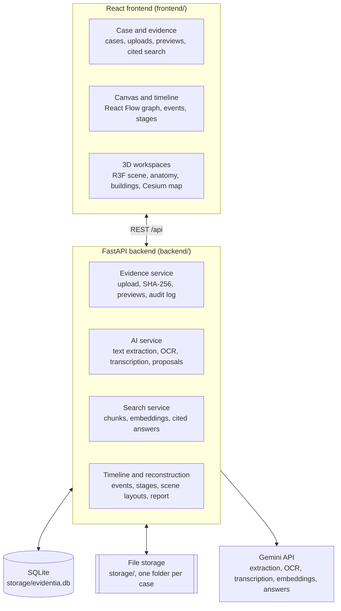

# Evidentia Development Plan

Evidentia is one integrated AI forensic investigation platform. An officer creates a case, collects evidence, discovers relationships, reconstructs what may have happened, and explores the incident in geographic and 3D views. Every module reads the same case records, so the canvas, timeline, 3D scene and report all point back to the same evidence. The hackathon build delivers one complete road-accident investigation; anatomy, geographic and building views then extend the same architecture.

## MVP

The  build is done when one road-accident case runs through all nine steps below. Work on anatomy, Cesium and building views starts only after this list is complete.

- [ ] Create a case and open its workspace
- [ ] Upload evidence and inspect source files
- [ ] Ask questions about evidence with source citations
- [ ] Display an evidence relationship canvas
- [ ] Navigate a source-linked incident timeline
- [ ] Explore a prebuilt road-accident 3D scene
- [ ] Select scene objects and view evidence details
- [ ] Demonstrate a second reconstruction stage
- [ ] Show an investigation summary report

## Starting point: the UI draft

The UI draft is a frontend-only Google AI Studio export (Vite, React 19, TypeScript, Tailwind 4). It builds cleanly, but every screen renders one hard-coded homicide case, and nothing calls a backend or an AI model. It has no 3D, map or graph library.

| Area | Draft today | In this plan |
| --- | --- | --- |
| Data | One hard-coded case in `src/data/mockData.ts`; resets on refresh | SQLite behind FastAPI; seed data is the road-accident case |
| Case creation | Three-step modal pre-fills three fake files, then invents a victim, an injury, a timeline and a graph | Saves only what the officer enters |
| Evidence upload | Keeps file name and size only; guesses type from the name; same fake SHA-256 on every file | Stored original, computed SHA-256, real preview |
| AI Copilot | Canned reply after a 600 ms timer | Case-scoped search and answers that cite source passages |
| Relationship graph | Custom SVG with fixed node coordinates | React Flow canvas built from relationship records |
| Timeline | Static list with a category filter | Event editor linked to evidence and reconstruction stages |
| Crime scene | A static 2D box with three labels | React Three Fiber scene loaded from an authored layout |
| Autopsy | 2D SVG mannequin with injury dots | Kept until the 3D anatomy explorer (M5) replaces it |
| CCTV, phone records, GPS modules | Hard-coded images and text for the mock case | No separate module: CCTV and records are evidence items, GPS goes to the geographic view |
| Reports | `alert()` on export; text names the mock suspect | Summary assembled from case records |
| Dead code | `IndividualCaseView.tsx`, `Sidebar.tsx` are never imported | Delete |
| Branding | Title "My Google AI Studio App", package "react-example" | Evidentia |

The frontend track should also strip mock strings from `CaseWorkspace.tsx`, such as the "Julian Vance" fallbacks, "5 High-Suspicious Links", "4 AI Breakthrough Flags" and "Det. A. Sharma". Otherwise every new case shows the mock story. Running the prototype also shows counts that contradict the data (the Copilot greets with "14 evidence files" while the locker holds 4), and evidence cards and alerts pointing at a case ID (`CAS-2026-8801`) that doesn't exist.

## What each prototype screen needs

Each screen of the running prototype maps to the endpoints that replace its mock data. CCTV, phone records, GPS and the 2D crime scene have no endpoint of their own: their content becomes evidence items and the 3D and geographic views.

| Screen | What it shows | Served by |
| --- | --- | --- |
| Dashboard | Case counts, active investigations, pending AI reviews, storage used, status breakdown, incident map, alerts feed, investigators | `GET /api/dashboard`, `GET /api/alerts` |
| Header | Global case search, alerts bell, current investigator | `GET /api/cases?q=`, `GET /api/alerts`, `GET /api/investigators` |
| Cases directory | Cases with status, priority, lead, created date and evidence count; search and filters | `GET /api/cases?q=&status=&priority=` |
| Create case modal | Case details, evidence drop zone, suspects and witnesses | `POST /api/cases`, then `POST /api/cases/{id}/evidence` and `POST /api/cases/{id}/persons` |
| Global evidence | Evidence from every case, type filter, search | `GET /api/evidence?q=&type=` |
| Evidence inspector | Hash, AI summary, custody ledger, file export | `GET /api/evidence/{id}`, `GET /api/evidence/{id}/file` |
| Workspace header and overview | Case banner and status, counts, primary suspect, victim, graph preview | `GET /api/cases/{id}/workspace`, `PATCH /api/cases/{id}` |
| Investigation canvas | Nodes by type, labelled links, anomaly filter | `GET /api/cases/{id}/graph` |
| Timeline | Events by category, with AI notes | `GET /api/cases/{id}/events?category=` |
| Autopsy | Injury markers with type, severity, depth and time | `GET /api/cases/{id}/injuries` |
| Witnesses and POIs | Persons with role and notes | `GET /api/cases/{id}/persons` |
| AI Copilot | Chat with citation chips and suggested actions | `POST /api/cases/{id}/ask` |
| Dossier reports and Intelligence Hub | Case picker, four templates, AI and custody toggles, export | `POST /api/cases/{id}/reports` |
| Case settings | Custody integrity status | `POST /api/cases/{id}/verify` |

## Architecture



The frontend never talks to Gemini or the database directly. Every workspace loads the same `cases`, `evidence`, `events` and `relationships` records through the API, and each record opens its source evidence.

## Tech stack

The stack keeps the draft's frontend and adds a Python backend. The database is a single SQLite file, so nobody installs a database server. The models avoid PostgreSQL-only types, so moving to PostgreSQL later means changing `DATABASE_URL` and the search function.

| Layer | Choice | Used for |
| --- | --- | --- |
| Frontend | React 19, Vite, TypeScript (from the draft) | Investigation interface |
| UI kit | Tailwind CSS 4, shadcn/ui | Forms, panels, dialogs |
| Client data | TanStack Query for server data, Zustand for UI state | Fetching, caching, selection and stage state |
| Routing | React Router | Dashboard, cases, case workspace |
| Relationship canvas | React Flow (`@xyflow/react`) | Evidence graph |
| 3D | Three.js, React Three Fiber 9, Drei | Crime scene, anatomy, buildings |
| Geographic | CesiumJS | Terrain, roads, buildings, incident markers |
| Animation | GSAP | Camera moves, exploded views |
| Backend | Python 3.11+, FastAPI, Pydantic | API, AI pipeline, investigation logic |
| Database | SQLite in WAL mode, SQLAlchemy 2, Alembic | Shared case data model and migrations |
| Vector search | Embeddings stored with each chunk, ranked with numpy | Case-scoped search |
| File storage | Local `storage/` folder | Original evidence files |
| AI | Gemini API through `google-genai` | Extraction, OCR, transcription, embeddings, answers |
| Document text | PyMuPDF, `python-docx` | Text of digital PDFs and Word files, before falling back to OCR |
| 3D assets | Blender, exported as GLB | Authored scene models |

## Data model

One relational model serves every module, so the canvas, timeline, 3D scene and report never keep their own copy of the investigation. Design it before building more modules; it is the first Alembic migration.

| Table | Key fields | Read by |
| --- | --- | --- |
| `investigators` | id, name, badge_number, role, clearance_level | Case management, audit log, dashboard |
| `cases` | id, case_number, title, incident_type, status, priority, description, incident_at, lead_investigator_id, investigator_ids | Every module |
| `evidence` | id, case_id, type, title, description, notes, file_path, mime_type, size_bytes, sha256, collected_at, source, processing_status, summary, extracted_text | Evidence, AI, report |
| `evidence_chunks` | id, evidence_id, page, text, embedding (float32 bytes) | Search and cited answers |
| `evidence_links` | id, evidence_id, chunk_id, target_type, target_id, passage | Source link from any record back to its evidence |
| `persons` * | id, case_id, role (victim, witness, suspect, other), name, age, occupation, condition (uninjured, injured, deceased), contact, notes, details | Overview, canvas, timeline, scene |
| `objects` * | id, case_id, kind (vehicle, phone, weapon, item), label, details (plate, number, make, colour) | Canvas, scene |
| `locations` * | id, case_id, kind (incident site, witness position, vehicle position, zone, boundary), address, lat, lng, geometry (GeoJSON for zones and boundaries), building_id | Map, scene, canvas, dashboard map |
| `events` * | id, case_id, location_id, category, time_start, time_end, time_precision, certainty (established, hypothesis, disputed), description, ai_note | Timeline, reconstruction |
| `relationships` * | id, case_id, from_type, from_id, to_type, to_id, kind, label, confidence, flagged, notes | Canvas |
| `observations` * | id, case_id, subject_type, subject_id, statement, observed_at, author_id | AI review queue, conflicts, report |
| `conflicts` | id, case_id, observation_ids, description, status (open, resolved) | Review queue, alerts, report |
| `ai_runs` | id, evidence_id, task, model, output, created_at | Record of every AI output |
| `reconstructions` | id, case_id, scenario, version, assumptions, scene_file | Reconstruction, comparison |
| `reconstruction_stages` | id, reconstruction_id, stage_order, label, event_ids | Stage switching and playback |
| `scene_objects` | id, stage_id, model_id, object_id, label, position, rotation, scale (metres) | 3D crime scene |
| `scene_annotations` | id, reconstruction_id, stage_id, kind (note, measurement, viewpoint), data | Annotations, measurements, saved camera views |
| `injuries` * | id, case_id, person_id, body_region, structure_id, type, severity, depth, estimated_time, description | Anatomy explorer |
| `buildings` | id, geo_building_id, name, model_url, floors (floors, rooms, doors, windows, entrances) | Cesium and building viewer |
| `reports` | id, case_id, template, options, content, sha256, created_by, created_at | Report history and export |
| `audit_log` | id, actor_id, action (uploaded, viewed, modified, reviewed, exported), record_type, record_id, at, detail (before and after values) | Chain of custody, report |

Rules that come with it:

- Tables marked * also carry `origin` (ai or investigator) and `review_status` (pending, confirmed, rejected). Anything the AI creates starts as `pending`, keeps its source passage in `evidence_links`, and stays a proposal until an investigator confirms it. Every investigator correction is an `audit_log` entry with the before and after values.
- Events take a time range, a precision and a certainty, so approximate or disputed accounts don't need a fake exact time.
- The static layout of a scene comes from its file in `assets/3d/crime-scenes/scenes/`. `scene_objects` holds only what changes between stages or links to evidence, and `object_id` ties a placed model to its vehicle or item record. Evidence attaches to events, injuries and scene objects through `evidence_links`.
- Counts and progress in the UI are computed, never stored: evidence count, storage used, pending reviews, and progress as reviewed AI items over all AI items. The prototype's "AI confidence" score has no source and is dropped.
- List and structured fields (`investigator_ids`, `event_ids`, `observation_ids`, `details`, `geometry`, `floors`, `data`, `options`, `content`, `output`) are JSON columns and embeddings are float32 bytes, so the same models also run on PostgreSQL. Alembic runs with `render_as_batch=True`, because SQLite can't alter columns in place.

## Milestones

Each milestone leaves a working feature, and each becomes a GitHub milestone with the issues listed. M1 to M4, plus the audit, hash, report and AI output log parts of M8, make up the MVP.

| Milestone | Delivers | Issues to open | Hackathon scope |
| --- | --- | --- | --- |
| M1 Core platform | An officer creates a case and manages its evidence | Case CRUD API; Case Workspace UI; Evidence Upload API; Evidence Detail Panel; Dashboard and Alerts API; Global Case and Evidence Search | MVP |
| M2 AI intelligence | Questions answered with cited passages; extracted facts and conflicting statements queued for review | Document Text Extraction (PDF, DOCX); OCR and Transcription; Evidence Chunking and Indexing; Case-Scoped RAG; Cited AI Answers; Conflict Detection | MVP |
| M3 Investigation analysis | An explorable evidence graph and a source-linked timeline with stages | Evidence Graph; Vehicle and Object Records; Relationship Review; Incident Timeline; Competing Sequence Comparison; Reconstruction Stage Switching | MVP |
| M4 Crime scene | A navigable road-accident scene at more than one stage | GLB Asset Loader; Authored Scene Configuration; Evidence Markers; Object Inspection; Spatial Measurements; Scene Annotations and Camera Viewpoints | MVP |
| M5 Anatomy | An anatomy model with injury markers linked to the autopsy report | Anatomy Model Loader; Structure Selection; Structure Search, Isolation and System Filters; Injury Markers; Exploded View | Stretch |
| M6 Geographic context | The incident in its surroundings, with navigation into a scene or building | Cesium Scene; Incident Markers; Zones and Scene Boundaries; Building Selection; Geographic-to-Scene Navigation | Stretch |
| M7 Building viewer | A floor-by-floor interior with evidence markers | Floor Visibility; Room Selection; Building Dissection; Interior Evidence Markers; Line-of-Sight Analysis | After hackathon |
| M8 Production readiness | A traceable record: audit trail, file hashes, report export, then roles and performance | Audit Trail; File Integrity Verification; Report Export; AI Output Log; Access Controls; Performance Testing | MVP for audit trail, file integrity, report export and AI output log; the rest after hackathon |

## AI evidence pipeline

The MVP pipeline handles PDFs, Word documents, text, images that contain text, audio, and the soundtrack of short videos. Visual analysis of images, fingerprints and video waits until there are suitable models and test data. Every step runs in the backend.

1. **Ingest.** The upload endpoint saves the original under `storage/<case_id>/`, computes its SHA-256, writes an `audit_log` entry, sets `processing_status` to `queued`, and returns. The remaining steps run in a FastAPI background task.
2. **Extract text.** PyMuPDF reads digital PDFs, `python-docx` reads Word files, and plain text is read as is. Gemini does OCR on scans and images that contain text, and transcribes audio and video soundtracks.
3. **Structure.** Gemini returns JSON in a fixed schema: a summary, plus people, vehicles and other objects, locations, events, relationships and observations, each with the passage it came from. The raw output goes to `ai_runs`, the summary goes on the `evidence` row, and everything else is saved with `origin = ai` and `review_status = pending`.
4. **Index.** Split the text into page-sized chunks, embed them with Gemini, and store them in `evidence_chunks`.
5. **Answer.** A question and the previous turns of the conversation are embedded, this case's chunks are ranked by cosine similarity with numpy, and Gemini answers from the top chunks alone. It returns the chunk IDs it used and up to three suggested follow-up questions. The UI shows each cited passage next to its source file.
6. **Compare.** Observations about the same subject, place or time are grouped, and Gemini flags conflicting statements and missing information. These are saved as `conflicts` rows for review.

## API contract

The frontend codes against these routes. FastAPI publishes them at `/openapi.json`, and the frontend generates `src/lib/api-types.ts` from it with `openapi-typescript`, so backend and frontend types cannot drift. Until access control lands (M8), the frontend sends the investigator picked in the header bar as an `X-Investigator-Id` header, so the audit log records who did what.

| Router | Method | Path | Does |
| --- | --- | --- | --- |
| dashboard | GET | `/api/dashboard` | Case counts, status breakdown, pending reviews, storage used, incident map points, investigators with solved and active counts |
| dashboard | GET | `/api/alerts` | Recent alerts built from new conflicts, finished processing and pending reviews |
| cases | GET, POST | `/api/cases?q=&status=&priority=` | Search, filter or create cases; each row carries its evidence count |
| cases | GET, PATCH | `/api/cases/{id}` | Read or update one case |
| cases | GET | `/api/cases/{id}/workspace` | Case, persons, objects, evidence, events, relationships and injuries in one call, for the workspace overview |
| cases | GET | `/api/investigators` | Investigators for assignment and the header picker |
| evidence | GET | `/api/evidence?q=&type=` | Evidence across all cases, for the global locker |
| evidence | POST | `/api/cases/{id}/evidence` | Upload one or more files (multipart) |
| evidence | GET | `/api/cases/{id}/evidence` | Evidence list with processing status |
| evidence | GET, PATCH | `/api/evidence/{id}` | Metadata, hash, summary, extracted text, links and custody ledger; edit type and notes |
| evidence | GET | `/api/evidence/{id}/file` | Original file; logs a "viewed" or "exported" audit entry |
| evidence | POST | `/api/evidence/{id}/reprocess` | Run the pipeline again |
| evidence | POST | `/api/evidence-links` | Link evidence to an event, injury, scene object or other record |
| evidence | DELETE | `/api/evidence-links/{id}` | Remove a link |
| evidence | POST | `/api/cases/{id}/verify` | Recompute every file's SHA-256 and report any mismatch |
| people | GET, POST | `/api/cases/{id}/persons`, `/api/cases/{id}/objects`, `/api/cases/{id}/locations` | Persons, vehicles and objects, locations |
| people | PATCH, DELETE | `/api/persons/{id}`, `/api/objects/{id}`, `/api/locations/{id}` | Edit, confirm or remove |
| search | POST | `/api/cases/{id}/ask` | Answer, cited chunks with passage and evidence ID, suggested follow-ups |
| search | GET | `/api/cases/{id}/search?q=` | Ranked passages across the case |
| review | GET | `/api/cases/{id}/observations?status=pending` | AI review queue |
| review | PATCH | `/api/observations/{id}` | Confirm, edit or reject |
| review | GET | `/api/cases/{id}/conflicts` | Conflicting statements and gaps |
| review | PATCH | `/api/conflicts/{id}` | Mark resolved |
| graph | GET | `/api/cases/{id}/graph` | Nodes and edges for React Flow |
| graph | POST | `/api/cases/{id}/relationships` | Add a link |
| graph | PATCH, DELETE | `/api/relationships/{id}` | Confirm, reject or remove a link |
| timeline | GET, POST | `/api/cases/{id}/events?category=` | List, filter or create events |
| timeline | PATCH, DELETE | `/api/events/{id}` | Edit or remove an event |
| reconstruction | GET, POST | `/api/cases/{id}/reconstructions` | Scenarios for a case; two are fetched side by side to compare sequences |
| reconstruction | GET | `/api/reconstructions/{id}` | Stages with their scene objects and annotations |
| reconstruction | POST | `/api/reconstructions/{id}/stages` | Add a stage |
| reconstruction | PUT | `/api/stages/{id}/scene-objects` | Save a stage's object placements |
| reconstruction | GET, POST | `/api/reconstructions/{id}/annotations` | Notes, measurements and saved camera viewpoints |
| injuries | GET, POST | `/api/cases/{id}/injuries` | Injury markers (M5) |
| buildings | GET | `/api/buildings/{id}` | Building model and floors (M6, M7) |
| reports | POST | `/api/cases/{id}/reports` | Build and store a report for a template and options |
| reports | GET | `/api/reports/{id}` | A stored report with its SHA-256 |
| reports | GET | `/api/cases/{id}/audit` | Audit trail for the case |

A report holds the case summary, an evidence inventory with hashes, the timeline, confirmed findings, open conflicts and uncertainties, reconstruction scenarios with their assumptions and, when asked, AI insights and the custody ledger. The PDF is the browser's print of the report view, so the backend needs no PDF library.

## Directory and file plan

The repo keeps the frontend modular and isolates each 3D engine inside its own feature folder, so a workspace loads its models only when it opens.

```text
evidentia/                          repo root
├── README.md                      setup and run steps
├── .gitignore                     .env, storage/, node_modules/, .venv/
├── .env.example                   copy to .env; both apps read the root .env
├── frontend/                      the UI draft, moved here
│   ├── package.json               scripts: dev, build, gen:api
│   ├── components.json            shadcn/ui config
│   ├── tsconfig.json              @ alias points to src/
│   ├── vite.config.ts             /api proxy to :8000; reads the root .env, serves assets/
│   ├── index.html
│   └── src/
│       ├── main.tsx               router, QueryClientProvider
│       ├── index.css
│       ├── routes/
│       │   ├── DashboardPage.tsx
│       │   ├── CasesPage.tsx
│       │   └── CaseWorkspacePage.tsx  one tab per feature
│       ├── components/
│       │   ├── ui/                shadcn/ui generated parts
│       │   ├── layout/            header, sidebars, investigator picker
│       │   ├── cases/             case list, create-case modal
│       │   ├── evidence/          evidence cards, preview modal
│       │   └── shared/            citation chip, status badges
│       ├── features/
│       │   ├── case-management/   overview, status, investigators
│       │   ├── evidence-management/  upload, detail panel, previews
│       │   ├── ai-investigation/  ask panel, cited answers, review queue
│       │   ├── evidence-canvas/   React Flow graph, relationship review
│       │   ├── incident-timeline/ event editor, stage playback
│       │   ├── crime-scene/       R3F viewer, markers, measurements
│       │   ├── anatomy/           anatomy explorer, injury markers
│       │   ├── geographic-area/   Cesium viewer
│       │   ├── building-viewer/   floors, rooms, dissection
│       │   └── reports/           investigation summary
│       ├── lib/
│       │   ├── api.ts             fetch wrapper, X-Investigator-Id header
│       │   └── api-types.ts       generated from /openapi.json
│       ├── hooks/                 TanStack Query hooks per resource
│       ├── stores/                Zustand: selection, active stage, investigator
│       └── types/                 frontend-only types
├── backend/
│   ├── pyproject.toml
│   ├── alembic.ini
│   ├── alembic/                   env.py, versions/ (batch mode)
│   ├── seed_data/                 sample evidence files for the road-accident case
│   ├── app/
│   │   ├── main.py                FastAPI app, CORS, routers
│   │   ├── seed.py                loads the road-accident case
│   │   ├── core/
│   │   │   ├── config.py          settings from the root .env
│   │   │   ├── db.py              engine and session; check_same_thread off, WAL and foreign keys on
│   │   │   └── storage.py         save originals, SHA-256
│   │   ├── models/                SQLAlchemy tables
│   │   ├── schemas/               Pydantic request and response models
│   │   ├── routers/
│   │   │   ├── dashboard.py       dashboard and alerts
│   │   │   ├── cases.py           cases, workspace and investigators
│   │   │   ├── evidence.py        evidence, links and integrity check
│   │   │   ├── people.py          persons, objects and locations
│   │   │   ├── search.py          ask and search
│   │   │   ├── review.py          observations and conflicts
│   │   │   ├── graph.py
│   │   │   ├── timeline.py
│   │   │   ├── reconstruction.py
│   │   │   ├── injuries.py
│   │   │   ├── buildings.py
│   │   │   └── reports.py
│   │   └── services/
│   │       ├── evidence/          ingest, previews, audit log
│   │       ├── ai/                Gemini client, extraction, OCR, transcription
│   │       ├── search/            chunking, embeddings, numpy ranking, answers
│   │       ├── timeline/          event ordering, conflict grouping
│   │       └── reconstruction/    stages, scene layouts, report assembly
│   └── tests/
├── assets/                        served by Vite as static files
│   └── 3d/
│       ├── crime-scenes/
│       │   ├── library/           reusable GLB models
│       │   └── scenes/            authored layouts: transforms in metres
│       ├── anatomy/
│       └── buildings/
├── storage/                       git-ignored: evidentia.db, uploaded originals
└── docs/
    ├── PLAN.md                    this plan
    ├── architecture/
    ├── api/
    └── schemas/
```

Where each draft file goes, done in one commit before anyone branches:

| Draft file | Goes to |
| --- | --- |
| `ai-forensic-investigation-suite/` | `frontend/` |
| `main.tsx`, `index.css`, `index.html`, `tsconfig.json`, `vite.config.ts` | Stay, updated as in the tree above |
| `App.tsx` | Replaced by the router in `main.tsx` and the pages in `routes/` |
| `Header.tsx`, `CaseWorkspaceSidebar.tsx` | `components/layout/` |
| `CasesIndexView.tsx`, `CreateCaseModal.tsx` | `components/cases/` |
| `EvidenceLockerView.tsx`, `EvidencePreviewModal.tsx` | `components/evidence/` |
| `DashboardView.tsx` | `routes/DashboardPage.tsx` |
| `CaseWorkspace.tsx` (1,073 lines) | Split: each module goes to its `features/` folder |
| `AnatomicalViewer.tsx` | `features/anatomy/`, until the 3D explorer replaces it |
| `NetworkGraphViewer.tsx` | Replaced by React Flow in `features/evidence-canvas/` |
| `ReportsGeneratorView.tsx` | `features/reports/` |
| `types.ts` | `types/`, then replaced by generated `api-types.ts` |
| `data/mockData.ts` | Removed; `backend/app/seed.py` holds the road-accident case |
| `IndividualCaseView.tsx`, `Sidebar.tsx` | Deleted |
| `README.md`, `metadata.json`, `.env.example`, `bun.lock` | Deleted; the root `README.md` and `.env.example` replace them |

## Environment setup

Every developer needs Node.js 20 or later, Python 3.11 or later and Git. The database is one SQLite file, so there is no database server to install. Blender is needed only by whoever authors the 3D assets.

Copy `.env.example` to `.env` at the repo root and fill it in:

| Variable | Used by | Value |
| --- | --- | --- |
| `DATABASE_URL` | backend | `sqlite:///../storage/evidentia.db` |
| `GEMINI_API_KEY` | backend | Key from Google AI Studio |
| `GEMINI_MODEL` | backend | Gemini model for extraction and answers |
| `GEMINI_EMBED_MODEL` | backend | Gemini embedding model |
| `STORAGE_DIR` | backend | `../storage` |
| `VITE_CESIUM_ION_TOKEN` | frontend | Cesium ion token for terrain and OSM buildings; needed from M6 |

Packages:

- **Frontend, add:** `react-router-dom`, `@tanstack/react-query`, `zustand`, `@xyflow/react`, `three`, `@react-three/fiber`, `@react-three/drei`, `gsap`, shadcn/ui through `npx shadcn@latest init`, and `openapi-typescript` as a dev dependency. Add `cesium` and `vite-plugin-static-copy` at M6.
- **Frontend, remove:** `express`, `@types/express`, `dotenv`, `tsx` and `@google/genai`, because AI calls move to the backend. Use npm, so there is one lockfile.
- **Backend:** `fastapi`, `uvicorn[standard]`, `sqlalchemy`, `alembic`, `pydantic-settings`, `python-multipart`, `google-genai`, `pymupdf`, `python-docx`, `numpy`; `pytest` and `httpx` for tests. SQLite itself ships with Python.

Configuration the scaffold needs:

- Point the `@` alias at `src/` in both `tsconfig.json` and `vite.config.ts` before running `npx shadcn@latest init`. The draft points it at the project root.
- In `vite.config.ts`, set `envDir: '..'` so Vite reads the root `.env`, and `publicDir: '../assets'` so GLB files are served from `/3d/...`. In `core/config.py`, read `../.env`.
- Add a `gen:api` script: `openapi-typescript http://localhost:8000/openapi.json -o src/lib/api-types.ts`. Run it after any backend schema change.
- For Cesium (M6), copy its static assets with `vite-plugin-static-copy` and define `CESIUM_BASE_URL`, as in Cesium's official Vite example.

`alembic upgrade head` creates `storage/evidentia.db`; delete that file to start from an empty database. To run everything (PowerShell):

```powershell
# 1. Backend on http://localhost:8000 (API docs at /docs)
cd backend
python -m venv .venv
# If activation is blocked: Set-ExecutionPolicy -Scope CurrentUser RemoteSigned
.venv\Scripts\Activate.ps1
pip install -e .
alembic upgrade head
python -m app.seed
uvicorn app.main:app --reload --port 8000

# 2. Frontend on http://localhost:3000, in a second terminal
cd frontend
npm install
npm run dev
```

## Schedule

Four tracks work in parallel and merge into `main` at hours 2, 6, 11 and 14, running the case flow end to end at each merge. The MVP is complete at hour 18.

| Hours | Backend | AI | Frontend | 3D crime scene |
| --- | --- | --- | --- | --- |
| 0 to 2 | FastAPI skeleton, schema, seed case | Gemini client, PDF text extraction | Move the draft, router, Query client | R3F viewer, GLB loader |
| 2 to 6 | Case, workspace and evidence APIs, audit log | OCR, transcription, structured facts | Workspace, upload, evidence panel | Author the road-accident layout |
| 6 to 11 | Graph, timeline and review endpoints | Chunking, embeddings, cited answers | React Flow canvas, timeline editor | Object selection, evidence markers |
| 11 to 14 | Reconstruction, report and dashboard endpoints | Conflicting statements for review | Cited ask panel, report view, dashboard | Measurements, camera viewpoints |
| 14 to 18 | Integration fixes | Tune prompts on the seed case | Stage playback, link to the 3D scene | Second reconstruction stage |

The 6-hour offline round starts with the stretch milestones, M5 anatomy and then M6 Cesium, for the first 4 hours. Features freeze at hour 4, and only fixes go in after that.

## Team and git workflow

Each track owns separate folders, so branches rarely touch the same files.

| Track | Owns |
| --- | --- |
| Backend | `backend/app/core`, `models`, `schemas`, `routers`, `services/evidence`, `services/timeline`, `services/reconstruction`, `alembic/`, `seed_data/` |
| AI | `backend/app/services/ai`, `services/search` |
| Frontend | `frontend/`, except the 3D feature folders |
| 3D | `features/crime-scene`, then `anatomy`, `geographic-area`, `building-viewer`, plus `assets/3d/` |

Rules:

- Open one GitHub milestone per M1 to M8 and one issue per item. Name branches by milestone and track, such as `m1/backend-case-api` or `m4/3d-scene-loader`.
- Merge to `main` through pull requests at each checkpoint. `main` must always start.
- Change API types in the FastAPI schemas first, then run `npm run gen:api`.
- Never commit `.env` or `storage/`. Commit optimized GLB exports, not raw Blender sources, and keep each file under GitHub's 100 MB limit.
